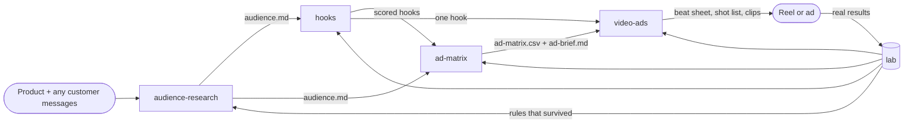
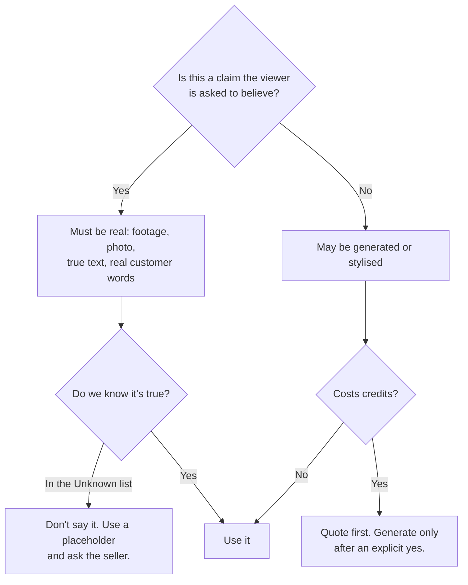
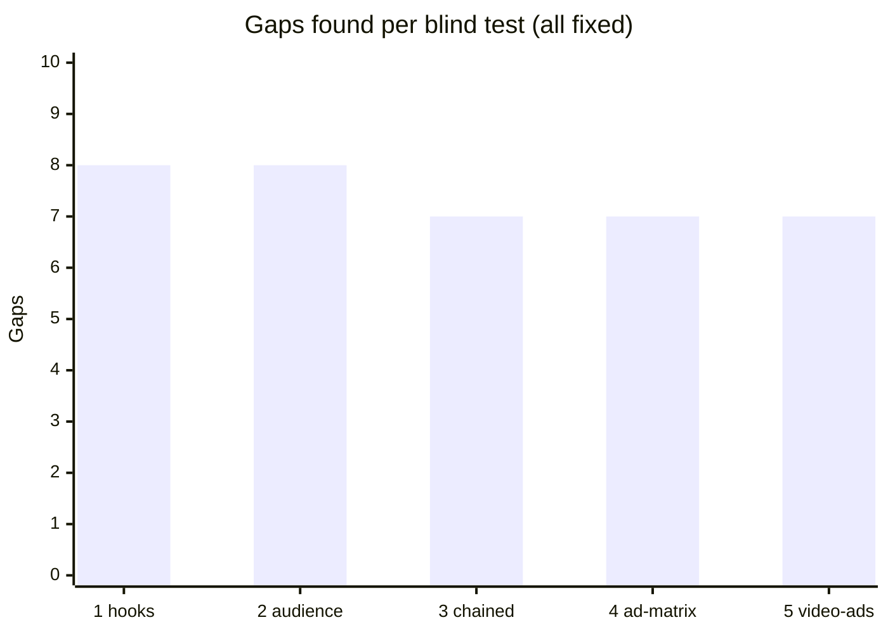

# marketing-god

A Claude Code plugin that takes a product from "who buys this?" to a tested batch of ads and a short video, with every step written
down as an exact process. Four skills chain together, and each one refuses to make things up: research lines are tagged with where they
came from, hooks are scored, ad claims must be true, and nothing is generated with AI until a quoted cost is approved.

> **Status: early.** The skills were built from about 85 marketing reels and blind-tested on invented products. They have run on one real
> product (a plan and a reel script) and generated one draft clip. Nothing here has been validated against real ad results yet.
> See [Status and limits](#status-and-limits).

## The pipeline



| Skill | What it does | What you get |
|---|---|---|
| [`audience-research`](skills/audience-research/SKILL.md) | Sorts real customer messages and reviews into problems, objections, desires and exact words, each tagged by source | `audience.md` |
| [`hooks`](skills/hooks/SKILL.md) | Writes and scores the first line and first three seconds; rates and fixes hooks you bring | Top 5 hooks with visual, text, spoken line and score |
| [`ad-matrix`](skills/ad-matrix/SKILL.md) | Plans ads as hooks × bodies × calls to action across different formats, sized to what you can make and afford to test | `ad-matrix.csv`, `ad-brief.md`, a test plan |
| [`video-ads`](skills/video-ads/SKILL.md) | Turns a hook into a beat sheet, splits real footage from AI-generated parts, routes to Higgsfield, gates on cost | Beat sheet, shot list, reviewed clips |

The full step-by-step process for each skill, with flowcharts, is in **[docs/PROCESS.md](docs/PROCESS.md)**.
Worked examples are in **[examples/](examples/README.md)**.

## Install

In Claude Code:

```
/plugin marketplace add Ekveer-Sahoo/marketing-god
/plugin install marketing-god@marketing-god
```

Or, for local development, start Claude Code with the folder as a plugin directory:

```bash
claude --plugin-dir /path/to/marketing-god
```

`video-ads` uses the Higgsfield connector for generation. Without it, the skill still produces the beat sheet, shot list and prompts.

## Quick start

Ask in plain words; the skills trigger on the request.

| You say | Skill |
|---|---|
| "Do audience research for my product. Here are some DMs I've had: …" | audience-research |
| "Give me hooks for an Instagram reel for …" | hooks |
| "Rate this hook: '…'" | hooks (score mode) |
| "Make me ads for … Budget ₹500 a day, I can make 8 this week." | ad-matrix |
| "Make the reel for … using this hook." | video-ads |

## The rules every skill shares



- **Evidence is graded.** `[own]` customer words beat `[public]` reviews, which beat `[inferred]`, which beat `[assumed]`.
- **No invented proof.** No fake reviews, numbers, testimonials, customers or process footage.
- **Write to the buyer** when buyer and user differ.
- **Capacity and budget are hard limits.** A plan you can't produce or afford to test is worth nothing.
- **Other people's rights.** No third-party characters, logos or likenesses; customer quotes and faces need permission.

## Repository layout

```
.claude-plugin/     plugin and marketplace manifests
skills/             the four skills, each with SKILL.md and references/
docs/PROCESS.md     exact processes and flowcharts
examples/           worked examples from test runs and the first real product
curriculum/         study notes the skills were built from (reels ledger + five topic files)
lab/                rubric, error taxonomy, skill-test log, product files, video tests
tools/              reel.py and digest.py for studying short videos in bulk
```

## How it was built

1. **Study.** 122 short videos and posts were collected; 105 videos were transcribed and reviewed frame by frame, 14 image posts read.
   Notes are in [`curriculum/`](curriculum/README.md).
2. **Encode.** Lessons that were specific and repeatable became skill instructions.
3. **Blind-test.** A fresh agent was given only the skill files and a sample product, then asked to critique the skill.
   Five tests found 37 gaps; all were fixed. Log: [`lab/skill-tests.md`](lab/skill-tests.md).
4. **Lab** (not started at scale). Run on real products, score against [`lab/rubric.md`](lab/rubric.md), tag errors, promote any error
   seen on 3+ products to a rule. Process: [`lab/README.md`](lab/README.md).



## Status and limits

- **Not validated on results.** No ad built with these skills has run, so nothing proves the hook scores or test plans predict performance.
- **Platform advice is practitioner opinion.** Claims about Meta's delivery, how many ads to run and when to cut come from creators'
  reels, not platform documentation. The skills label them as rules of thumb.
- **Campaign setup is out of scope.** `ad-matrix` plans creatives and the test; it does not configure ad accounts.
- **One generated clip so far**, and it was unusable (a third-party logo became readable). See
  [`lab/video-tests/0001-drone-draft/notes.md`](lab/video-tests/0001-drone-draft/notes.md).
- **Thin spots in the source material:** positioning, offer design, awareness levels, email and landing pages are noted as gaps in
  [`curriculum/README.md`](curriculum/README.md).
- **Source media is not in this repository.** The frames, captions and transcripts of the videos studied are kept privately; the
  ledger here holds our own notes on them, with each creator credited by handle.
