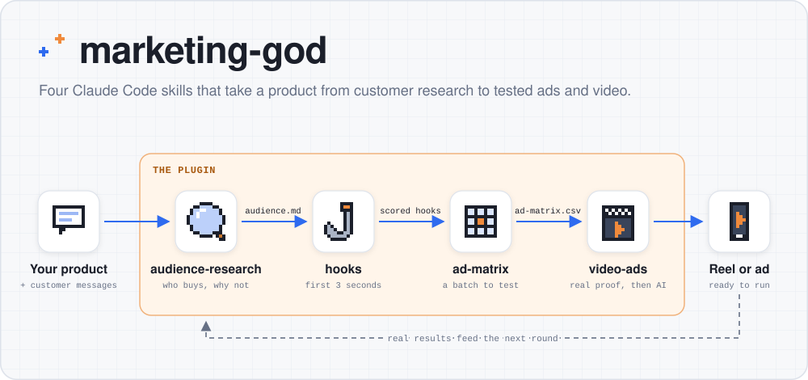

<p align="center">
  
</p>

<p align="center">
  <a href="LICENSE"></a>
  
  
  
</p>

<p align="center">
  <a href="#install">Install</a> ·
  <a href="#see-it-work">See it work</a> ·
  <a href="#the-four-skills">Skills</a> ·
  <a href="docs/PROCESS.md">Process guide</a> ·
  <a href="examples/README.md">Examples</a> ·
  <a href="#status-and-limits">Status</a>
</p>

---

Four skills that chain together, each written as an exact process. They are built to **not make things up**: research is tagged with
where it came from, hooks are scored, ad claims must be true, and nothing is generated with AI until you approve a quoted cost.

## See it work

You bring a hook. The `hooks` skill scores it, says what's wrong, and rewrites it.

<table>
<tr>
<th width="50%">Before</th>
<th width="50%">After</th>
</tr>
<tr>
<td valign="top">

> "Check out our amazing new custom keychains, they are a total game-changer for gifting!"

**3 / 12**

- About the seller, not the buyer
- Any competitor could post it unchanged
- "Amazing" and "game-changer" say nothing
- Nothing left to find out

</td>
<td valign="top">

> **Visual:** a plastic keychain drops into the plating tank; the same piece lifts out copper.<br>
> **Text:** Plastic in. Real copper finish out.<br>
> **Says:** "This went into the tank as plastic. This is the same piece coming out."

**10 / 12**

- The change happens in frame one, sound off
- Only this product could say it
- You stay to see how

</td>
</tr>
</table>

More outputs, including an audience file, an eight-ad matrix and a reel plan: **[examples/](examples/README.md)**.

## The four skills

| | Skill | You give it | You get |
|:-:|---|---|---|
| 🔎 | **[audience-research](skills/audience-research/SKILL.md)** | The product and any real customer messages | `audience.md`: problems, objections, desires and exact words, each tagged by source |
| 🎣 | **[hooks](skills/hooks/SKILL.md)** | A product, or a hook to rate | Top 5 hooks with visual, on-screen text, spoken line and a score out of 12 |
| 🧮 | **[ad-matrix](skills/ad-matrix/SKILL.md)** | Budget, footage, how many ads you can make | `ad-matrix.csv` and `ad-brief.md`: hooks × bodies × CTAs, a break-even and a cut rule |
| 🎬 | **[video-ads](skills/video-ads/SKILL.md)** | A hook and the footage you have | A beat sheet and shot list; AI clips only after a cost quote and your yes |

Each skill reads what the one before it wrote. The step-by-step process for each, with flowcharts, is in
**[docs/PROCESS.md](docs/PROCESS.md)**.

## Install

In Claude Code:

```
/plugin marketplace add Ekveer-Sahoo/marketing-god
/plugin install marketing-god@marketing-god
```

For local development:

```bash
claude --plugin-dir /path/to/marketing-god
```

`video-ads` uses the Higgsfield connector to generate clips. Without it you still get the beat sheet, shot list and prompts.

## Use it

Ask in plain words; the skills trigger on the request.

| Say this | Runs |
|---|---|
| "Do audience research for my product. Here are some DMs I've had: …" | audience-research |
| "Give me hooks for an Instagram reel for …" | hooks |
| "Rate this hook: '…'" | hooks |
| "Make me ads for … Budget ₹500 a day, I can make 8 this week." | ad-matrix |
| "Make the reel for … using this hook." | video-ads |

## The rules every skill follows

| Rule | What it means in practice |
|---|---|
| **Evidence is graded** | Your customers' words `[own]` beat public reviews `[public]`, which beat interpretation `[inferred]`, which beats guesses `[assumed]`. Every research line carries its tag. |
| **Real for proof, generated for attention** | Anything the viewer is asked to believe (the product, a result, a customer, how it's made) must be real. AI is for openers, b-roll and transitions. |
| **No invented proof** | No fake reviews, numbers, testimonials, customers or process footage. Unknown facts become placeholders and questions, not claims. |
| **Cost gate** | Checking a balance and getting a quote are free. Generating needs your explicit yes to a quoted cost, one draft first. |
| **Write to the buyer** | When the buyer and the user differ (parent and child, gift giver and receiver), the copy addresses the buyer. |
| **Capacity and budget are limits** | A plan you can't produce or afford to test is worth nothing, so plans are sized to both. |
| **Other people's rights** | No third-party characters, logos or likenesses. Customer quotes and faces need permission. |

## How it was built

| 1,138 | 4 | 5 | 37 |
|:-:|:-:|:-:|:-:|
| short videos and posts studied | skills written | blind tests run | gaps found and fixed |

1. **Study.** 693 videos were transcribed and 445 carousel captions read; about 280 taught nothing and many of the rest repeat each
   other. The first 160 were reviewed frame by frame, the rest from transcripts and captions. Notes, with each creator credited:
   [`curriculum/`](curriculum/README.md); what round 2 added: [`curriculum/06-round2-synthesis.md`](curriculum/06-round2-synthesis.md).
2. **Encode.** Lessons that were specific and repeatable became skill instructions.
3. **Blind-test.** A fresh agent got only the skill files and a sample product, then critiqued the skill. Log: [`lab/skill-tests.md`](lab/skill-tests.md).
4. **Lab** (not yet run at scale). Real products, scored against a rubric; any error seen on three or more products becomes a rule. Process: [`lab/README.md`](lab/README.md).

## Status and limits

This is early work. Read this before relying on it.

- **Not validated on results.** No ad built with these skills has run yet, so nothing proves the hook scores or test plans predict performance.
- **Platform advice is practitioner opinion.** Claims about ad delivery, how many ads to run and when to cut come from creators' reels,
  not platform documentation. The skills label them as rules of thumb.
- **Campaign setup is out of scope.** `ad-matrix` plans creatives and the test; it does not configure an ad account.
- **One generated clip so far**, and it was unusable. [Why](lab/video-tests/0001-drone-draft/notes.md).
- **The test products are invented.** One real product has a plan and a reel script: [`lab/products/`](lab/products/).

<details>
<summary><b>Repository layout</b></summary>

```
.claude-plugin/     plugin and marketplace manifests
skills/             the four skills, each with SKILL.md and references/
docs/PROCESS.md     exact processes and flowcharts
examples/           worked examples from test runs and the first real product
curriculum/         study notes the skills were built from
lab/                rubric, error taxonomy, skill-test log, product files, video tests
tools/              reel.py and digest.py for studying short videos in bulk
```

</details>

<details>
<summary><b>What's missing from the source material</b></summary>

Positioning, offer design, awareness levels, email and landing pages are thin; see [`curriculum/README.md`](curriculum/README.md).
The frames, captions and transcripts of the videos studied are kept privately and are not in this repository; the ledger here holds
our own notes on them.

</details>

## Credits

The banner is drawn by [`assets/make_banner.py`](assets/make_banner.py), following the diagram rules of
[stack-diagram](https://github.com/caru-ini/stack-diagram) (graph-paper canvas, white tiles, one accent, orthogonal labelled arrows)
and the pixel-art rules of [pixelfx](https://github.com/patch-gg/pixelfx) (hard grid, small palettes, one ink line, no smooth gradients).

## Licence

[MIT](LICENSE). The licence covers this repository's own code and writing. Creators named in `curriculum/` own their original videos
and posts; the notes here are commentary on them.
