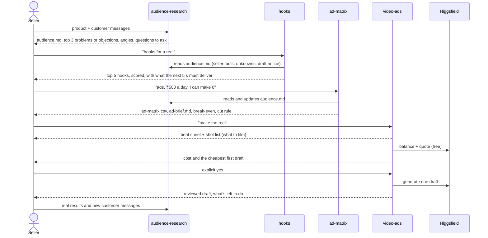
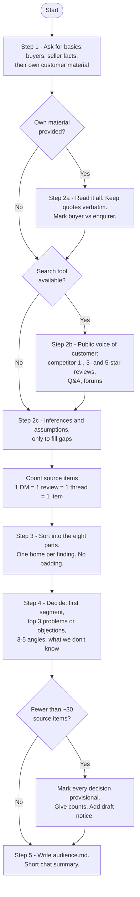
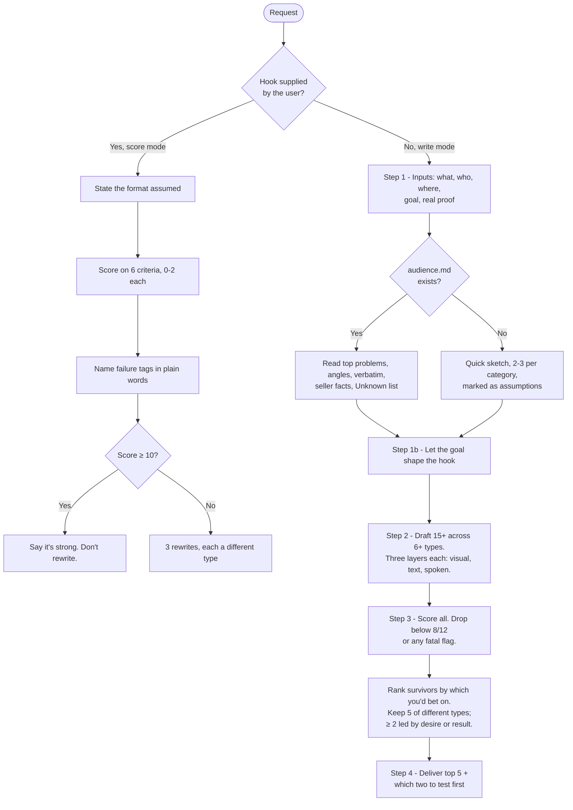
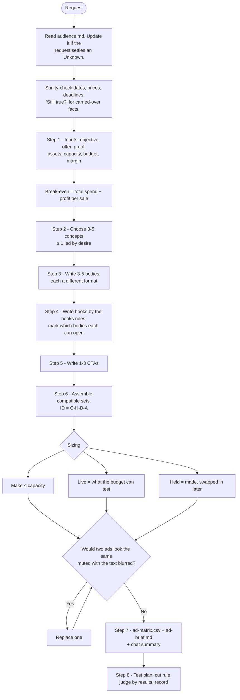
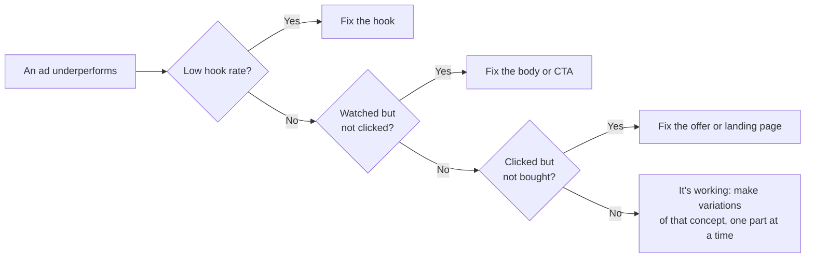
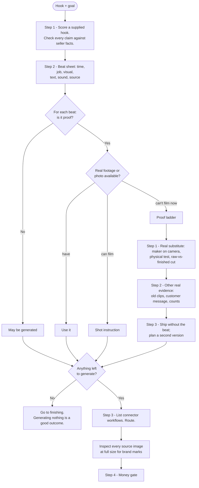
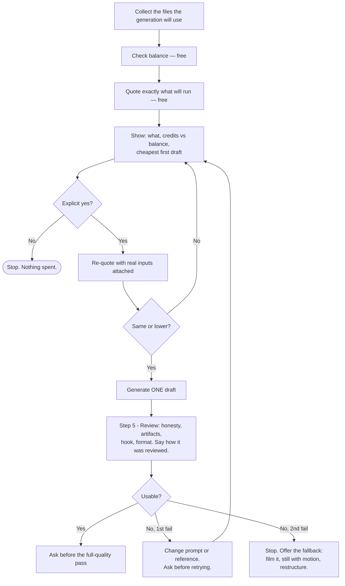
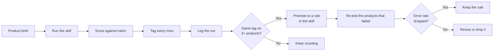
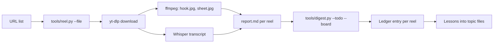
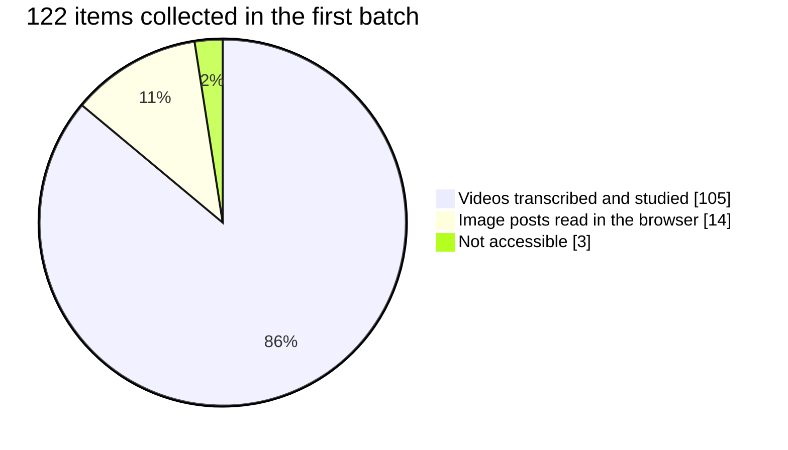

# The exact process

How each skill runs, step by step, with the decision points drawn out. The skill files are the source of truth; this page is the map.

- [0. End to end](#0-end-to-end)
- [1. audience-research](#1-audience-research)
- [2. hooks](#2-hooks)
- [3. ad-matrix](#3-ad-matrix)
- [4. video-ads](#4-video-ads)
- [5. The lab loop](#5-the-lab-loop)
- [6. Studying reels in bulk](#6-studying-reels-in-bulk)

---

## 0. End to end

| Stage | Input | Output file | Gate before moving on |
|---|---|---|---|
| Research | Product, seller facts, customer messages | `marketing/<slug>/audience.md` | A best first segment and three problems or objections are chosen, with counts |
| Hooks | `audience.md`, platform, goal | (in chat) top 5 | Every hook ≥ 8/12, no fatal flag, nothing from the Unknown list claimed |
| Matrix | Audience, hooks, capacity, budget | `ad-matrix.csv`, `ad-brief.md` | Made set covers every concept and ≥ 3 formats; break-even stated |
| Video | One hook or matrix row, footage on hand | Beat sheet, clips | Proof beats are real; cost approved before any generation |
| Learn | Results from the platform and from the seller's own tally | Sheet result columns, `lab/` | Winners explained by part (concept, hook, body, CTA) |

---

## 1. audience-research

**Use when:** a product has no audience file, the user pastes reviews or DMs, or copy keeps coming out generic.

### Evidence tags

| Tag | Meaning | Trust |
|---|---|---|
| `[own]` / `[own buyer]` | Said by the seller's own prospects / paying customers | Highest |
| `[public: source]` | Said by other sellers' customers in the category | Medium |
| `[inferred: from …]` | An interpretation of a named piece of evidence | Reasoned guess |
| `[assumed]` | No source | Hypothesis |

### The eight parts
1 Problems · 2 Frustrations with current options · 3 Desired outcomes · 4 Repeated questions · 5 Common mistakes ·
6 Objections and limiting beliefs · 7 Emotional reasons underneath · 8 Their words (verbatim only)

**Rules:** quotation marks only for verbatim text · strip names and handles · record who it's *not* for · update the file when facts or
results change.

Example: [drone workshop audience file](../examples/drone-workshop/audience.md).

---

## 2. hooks

**Use when:** writing or rating the first line and first three seconds of anything.

### Scoring (0-2 each, 12 total)

| Criterion | 2 means |
|---|---|
| Specific | A number, named situation or concrete object carries the line |
| For the viewer | Names their situation, or shows the result they want happening |
| Opens a loop | A question they need answered, and the piece answers it |
| Clear in one read | Lands in under two seconds |
| Works muted | Movement or an odd image in frame one, plus readable text |
| Not swappable | Rests on something only this offer has |

**Fatal flags:** can't pay off · invented proof · overstated product · banned opener · misleading native format.

### How the goal changes the hook

| Goal | The hook should |
|---|---|
| Sales, DMs, leads | Show the product or result and the buyer's situation; price can be in the hook |
| Reach | Be broad and visual; curiosity anyone gets |
| Comments | Imply a question with an easy answer |
| Saves | Promise a list, steps or settings |
| Shares | Name a person the viewer knows |
| Followers | Promise a series |

Examples: [keychain hooks and a scored bad hook](../examples/keychain/hooks.md) ·
[drone workshop hooks](../examples/drone-workshop/hooks.md).

---

## 3. ad-matrix

**Use when:** planning ad creatives, a creative test, or variations of a winner.

### Reading the results

**Scope:** creatives and how to read the test. Campaign setup is not covered. Platform numbers are rules of thumb.

Example: [drone workshop matrix](../examples/drone-workshop/ad-matrix.csv) and [brief](../examples/drone-workshop/ad-brief.md);
[the chat reply that came with them](../examples/drone-workshop/ad-matrix-reply.md).

---

## 4. video-ads

**Use when:** a hook, script or ad needs to become a finished short video.

### The money gate

### Beat sheet format

| # | Time | Job | Visual | On-screen text | Voice / sound | Source |
|---|---|---|---|---|---|---|
| 1 | 0-3 | Hook | … | … | … | have / film / generate / screen / graphic |

Jobs in order: hook → proof or demo → what it is and what you get → objection → CTA.

Examples: [keychain reel when the process can't be filmed](../examples/keychain/video-plan.md) ·
[wallet reel 01](../lab/products/magsafe-wallet-reel-01.md) ·
[first generated draft and its review](../lab/video-tests/0001-drone-draft/notes.md).

---

## 5. The lab loop

Real numbers (CTR, cost per result, sales) override rubric scores. Files: [`lab/README.md`](../lab/README.md),
[`lab/rubric.md`](../lab/rubric.md), [`lab/error-taxonomy.md`](../lab/error-taxonomy.md).

### Two kinds of test, don't mix them up

| | Blind skill test | Lab run |
|---|---|---|
| Question | Do the instructions work? | Does the output perform? |
| Product | Invented | Real |
| Judge | A fresh agent's critique | Rubric, then real results |
| Log | [`lab/skill-tests.md`](../lab/skill-tests.md) | `lab/runs/`, `lab/scoreboard.csv` |
| Done so far | 5 | 0 scored |

---

## 6. Studying reels in bulk

How the source material was gathered; reuse it for the next batch.

Limits: Whisper drops chunks of Hindi and Hinglish audio, so on-screen text and captions were the dependable source; image carousels
and login-gated reels need the browser.
